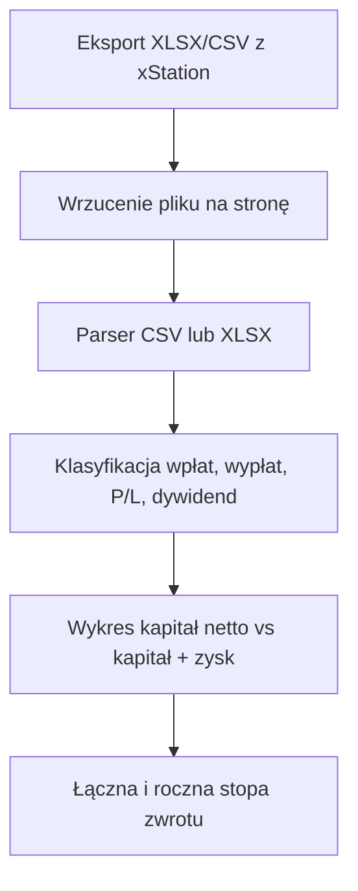

# Plan: panel wyników XTB

## Problem

Inwestor XTB ma historię w xStation, ale platforma nie pokazuje w prosty sposób:

1. ile łącznie wpłacił w czasie,
2. jaki zysk ta historia faktycznie wyprodukowała,
3. jaka jest łączna i roczna stopa zwrotu.

Aplikacja ma to policzyć po wrzuceniu eksportu i pokazać na jednej czytelnej stronie.

## Zakres MVP

Wchodzi:

- import XLSX z xStation (oba arkusze) oraz CSV tych tabel
- wykres: kumulatywny kapitał netto (wpłaty − wypłaty) vs kapitał netto + zysk; tryb prosty (dzień + suwak przybliżenia) i zaawansowany (dzień/miesiąc/rok + suwak)
- karta podsumowania: łączna wartość netto portfela
- karty: łączna stopa zwrotu, roczna (XIRR), suma wpłat, zysk
- opcjonalne pole „aktualna wartość konta” (otwarte pozycje)
- analiza w 100% w przeglądarce
- przykładowe dane do szybkiego podglądu UI

Nie wchodzi w MVP:

- logowanie, baza, zapis plików na serwerze
- PIT-38 / podatek Belki
- porównanie z inflacją
- otwarte pozycje z osobnego eksportu (tylko szacunek przez saldo)
- wielowalutowość

## Przepływ użytkownika



## Definicje metryk

### Wykres

- **Niebieska linia** — kumulatywny kapitał netto: suma wpłat minus suma wypłat (wraz z transferami zewnętrznymi, gdy widok jednego konta).
- **Zielona linia** — szacowana wartość portfela (wpłaty i zyski zwiększają wartość; wypłaty ją zmniejszają, nie poniżej zera; na końcu zgodna z kartą podsumowania).

Karta „Aktualny kapitał wpłacony” pokazuje wpłaty minus wypłaty (ujemna wartość na zielono z minusem).

### Suma wpłat (w raporcie wewnętrznym)

Suma wszystkich operacji sklasyfikowanych jako `deposit`. Wypłaty **nie** pomniejszają tej linii — użytkownik pyta o sumę wpłat.

### Zysk wyprodukowany

```
zysk = Σ Net P/L zamkniętych pozycji
     + dywidendy + odsetki
     + withholding tax (ujemny)
     + inne przepływy kasowe poza wpłatą, wypłatą, kupnem i sprzedażą
     + Profit z Open Positions (niezrealizowany)

`Close trade` w cash nie doliczamy, gdy jest arkusz zamkniętych pozycji.
```

`Net P/L = Gross P/L + prowizja + swap + rollover`

Jeśli użytkownik poda aktualne saldo:

```
zysk całkowity = saldo − (suma wpłat − suma wypłat)
niezrealizowany = zysk całkowity − zysk zrealizowany
```

### Łączna stopa zwrotu

```
łączna = zysk / suma wpłat
```

To prosta, czytelna miara. Nie jest money-weighted.

### Roczna stopa zwrotu

XIRR (jak Excel), rok = 365 dni.

Przepływy z perspektywy inwestora:

| Zdarzenie | Znak |
| --- | --- |
| Wpłata | ujemny |
| Wypłata | dodatni |
| Wartość końcowa | dodatnia (kapitał netto + zysk albo podane saldo) |

Kapitał netto = suma wpłat − suma wypłat.

## Format wejścia XTB

xStation: Historia konta → Eksportuj jako XLSX.

Aktualny eksport (2026):

| Arkusz | Kluczowe kolumny |
| --- | --- |
| Cash Operations | Type, Time, Amount, Comment, Ticker, Position ID |
| Closed Positions | Instrument/Ticker, Open/Close Time (UTC), Profit/Loss, Gross Profit |
| Open Positions | podsumowanie Product / Metric / Amount (Value, Profit) |

Starszy eksport: `CASH OPERATION HISTORY`, `CLOSED POSITION HISTORY`.

Parser skanuje nagłówki zamiast zakładać stałe kolumny. Aliasuje `Close Time (UTC)` i `Profit/Loss`.

Typy kasowe (case-insensitive): `Deposit`, `Withdrawal`, `IKE deposit` / `IKE return` / `IKZE deposit` (transfer między kontami), `Stock purchase` / `Stock sell`, `Dividend`, `Withholding tax`, `Tax from dividend…`, `IKE tax`, `Free funds interest`, `Close trade`, `Swap`, `Subaccount transfer`.

`Close trade` i kasowy `Swap` są pomijane w zysku, gdy arkusz zamkniętych pozycji już zawiera P/L (żeby nie liczyć dwa razy). Transfer subkonta nigdy nie jest wpłatą inwestora. Wynik otwartych pozycji z arkusza Open Positions doliczamy jako zysk niezrealizowany, dopóki użytkownik nie poda salda ręcznie.

## Stack (aktualny na 2026)

| Warstwa | Wybór | Powód |
| --- | --- | --- |
| Framework | Next.js 16 App Router, React 19, TypeScript | aktualny LTS, jeden język, hosting Vercel/Node |
| Styl | Tailwind CSS v4 | szybki, czytelny UI bez osobnego design systemu |
| Wykres | Recharts | prosty wykres liniowy w React |
| XLSX | fflate + XML | działa w przeglądarce, bez luk SheetJS |
| Testy | Vitest | szybkie testy czystych funkcji |

Świadomie bez bazy i API: plik nie opuszcza przeglądarki.

## Struktura kodu

- `src/lib/xtb` — parser i klasyfikacja
- `src/lib/analysis` — portfel i XIRR
- `src/components` — dropzone, wykres, karty
- `Rules` — zasady kodu i testów
- `src/**/*.test.ts` — testy jednostkowe

## Ryzyka

- XTB znowu zmieni nazwy arkuszy/kolumn → mapowanie po aliasach + test na fixturze
- Brak zamkniętych pozycji w CSV → ostrzeżenie, zysk tylko z cash
- XIRR bez przeciwnych przepływów → pokazujemy „—”
- Saldo otwartych pozycji: pole opcjonalne; jeśli plik ma arkusz Open Positions, bierzemy z niego Profit

## Później (nie teraz)

- PIT-38 / Belka
- inflacja GUS jako benchmark
- zapis lokalny (IndexedDB)
- wielowalutowość
- rozbicie zysku per symbol
